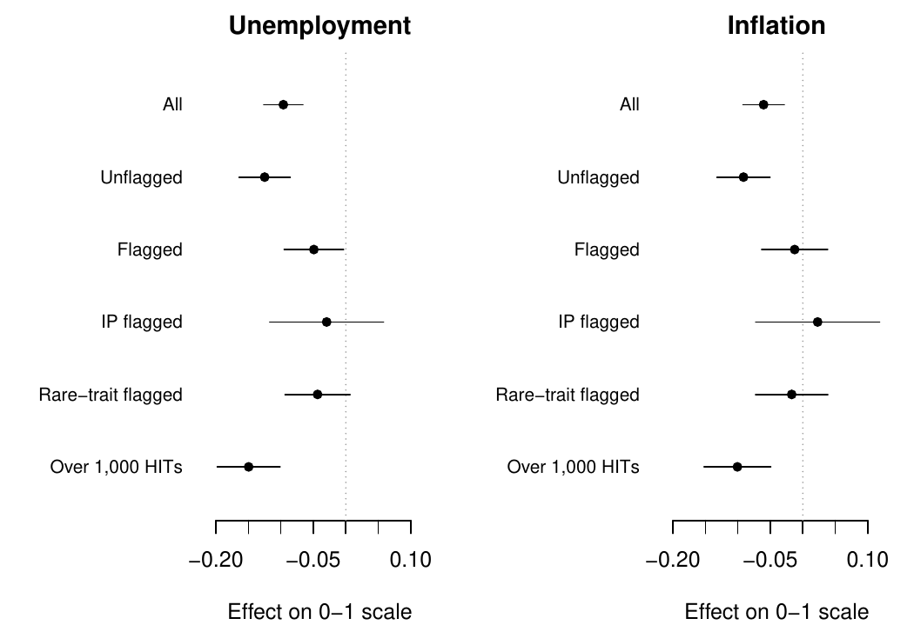

# The Micro-Task Market for Lemons

Douglas J. Ahler, Carolyn E. Roush, and Gaurav Sood

Three surveys conducted in 2018 and 2020 document response-quality concerns
on Amazon's Mechanical Turk. Suspicious-IP indicators flag
20.3%, 12.1%, 9.8% of responses in August
2018, June 2020, and July 2020. Combining those indicators with at least two
affirmative rare-item answers flags 24.6%, 37.9%, 27.6%.
These are screening rates in these samples. They do not identify dishonesty,
automation, or a platform-wide prevalence of low-quality respondents.

The June experiment's full-sample effects are
77.0% and 66.1% as large as the
effects among unflagged respondents for unemployment and inflation judgments.
Paired respondent-bootstrap 95% intervals are
62.2%–95.7% and 41.7%–92.0%.
The comparisons condition on observed response screens; excluding flagged
responses does not by itself identify an error-free treatment effect.



## Paper and replication

The [published paper](original/published.pdf) appeared in *Political Science
Research and Methods*, [doi:10.1017/psrm.2021.57](https://doi.org/10.1017/psrm.2021.57).
The [supplied supplement](original/supplement.pdf) is preserved with
[manuscript provenance](docs/paper-sources.csv).
The [original replication deposit](https://doi.org/10.7910/DVN/KF1LAK), version
1.0, was released on 6 August 2021. The [updated manuscript](ms/main.pdf)
rebuilds the analyses in R and distinguishes corrections, sensitivity analyses,
and measurement limitations. It is not a replacement publisher version.

The archived Stata logs provide reference estimates for the translation.
A licensed Stata executable was not available for a fresh original-code run.
The repository retains the deposited programs and logs; it does not treat
successful R execution as proof that every original program runs unmodified.

Verified changes include the following:

- Missing duration values were classified as slow in the original Stata code.
  Among respondents with observed duration, the August slow-response rate is
  11.25%, compared with the archived
  11.65% calculation.
- The original self-reported-insincerity comparison uses different thresholds
  across years. Applying the same “some of the time or more” threshold gives
  8.8%, 33.3%, 28.5% across the three studies.
- Nine missing IP addresses were grouped as one repeated address in the
  original multiplicity table. The updated table counts observed addresses.
- The historical attenuation spreadsheets contain an incorrect standard error
  and a sign reversal, and their weighting formula divides estimated variances
  by sample size again. Outcome-specific ratios and joint bootstrap intervals
  accompany the preserved historical calculations.
- Restricted comparison-survey code omits one duplicate flag and pools
  duplicates across separate surveys. The [aggregate comparisons](docs/restricted-ip-audit.csv)
  distinguish the implementation corrections from alternative grouping rules.
  Rebuilding those comparisons requires authorized access to data not in the
  public deposit.

The [claim inventory](docs/claims.csv) maps the paper and appendix to outputs.
[IP checks](docs/ip-audit.csv), [survey comparisons](tabs/survey_comparison.csv),
and [interpretation notes](docs/interpretation.csv) provide the evidence and scope
of the updates. The [data documentation](data/README.md) explains public-input
sanitization, retained variables, and the limits of the IP-service measures.

## Reproduce

Requires R 4.6, XeLaTeX, and `latexmk`, or Docker with the standard
`rocker/r-ver:4.6.0` image.

```sh
make restore
make check
```

Or run the complete isolated build:

```sh
make ci-docker
```

`make check` runs the analysis, regenerates figures, tables, this README and
the manuscript, then runs lint and tests. Both bootstrap analyses use 1,999
draws and a fixed seed. Set `TURK_CORES=4` to use four local processes;
results do not depend on the process count. No Stata license, private data,
or IP-service key is needed for the public build.

| Directory | Contents |
|---|---|
| `data/raw/` | Sanitized derivatives of the three deposited public study files |
| `R/` | Source checks, variable construction, estimates, diagnostics, and presentation |
| `scripts/` | Analysis and rendering entry points; optional source-preparation and restricted-data checks |
| `tabs/`, `figs/` | Generated numerical results, tables, and figures |
| `ms/` | Updated manuscript source and compiled PDF |
| `original/` | Preserved deposited code and logs, release metadata, and published paper |
| `docs/` | Source hashes, variable definitions, claim mappings, and aggregate audit evidence |
| `tests/testthat/` | Data, recoding, archived-result, inference, and privacy checks |

`README.Rmd` is the source of this page. Numerical values are read from the
same results as the manuscript. The original deposit and new code use CC0;
the published paper retains its publication rights.
